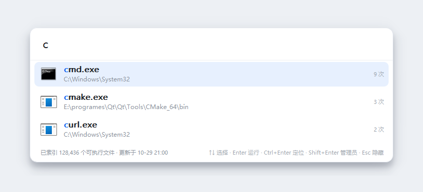

<div align="center">

# Listery

**Double-tap Ctrl, launch anything on your disk in a second.**

A Listary-style quick launcher written in Qt / C++: index every executable → double-tap Ctrl → type → instant results → ranked by how often you actually use them.

[](https://github.com/spygg/listery/actions/workflows/release.yml)
[](https://github.com/spygg/listery/releases)
[](LICENSE)
[](https://www.qt.io)
[](https://github.com/spygg/listery/releases)
[](CMakeLists.txt)

[简体中文](README.md) · [English](README_EN.md)

</div>

---




## Why Listery

| Feature | What it does |
| --- | --- |
| **Double-tap Ctrl** | Fires only on two Ctrl presses within 300 ms. A different key in between (`Ctrl+C`) cancels it, so your everyday shortcuts are safe |
| **Type-to-search** | 35 ms debounce + a background search thread. The UI thread never runs SQL, and stale results from earlier keystrokes are dropped |
| **Pinyin search** | `tengxunhuiyi`, `txhy` and `腾讯会议` all match the same app. Polyphonic characters keep every reading |
| **Learns your habits** | Score = `0.72 × match quality + 0.28 × usage habit`, so apps you use most bubble up |
| **Smart scanning** | Per-volume adaptive scheduling: volumes with no software back off automatically; on Linux it just reads the locate snapshot |
| **Portable** | Index, config and logs live next to the executable. Copy the folder to a USB stick and go |

## Quick start

1. Grab the archive for your platform from [Releases](https://github.com/spygg/listery/releases) and extract it;
2. Run `listery` (`listery.exe` on Windows). It drops to the tray and starts building the index;
3. **Double-tap Ctrl**, type a program name, press Enter.

> Windows XP users: download `listery-windows-xp.zip` (32-bit MinGW + Qt 5.7 build).

### Keyboard

| Key | Action |
| --- | --- |
| `Double Ctrl` | Show / hide the launcher |
| `↑` `↓` `PgUp` `PgDn` | Move through results |
| `Enter` | Launch the selected program |
| `Ctrl + Enter` | Reveal it in the file manager |
| `Shift + Enter` | Run as administrator |
| `Esc` | Hide the launcher |
| Right-click a result | Run as admin / open location / copy path |

## Smart indexing

A full traversal costs minutes and tens of thousands of syscalls, and most volumes simply have no software on them. So Listery doesn't blindly rescan every N hours:

### Per-volume adaptive scheduling

Every volume records how many executables the last scan found, when it ran, and how many consecutive empty rounds it has had. The refresh interval stretches accordingly (default base interval: 12 hours):

| Volume state | Refresh interval | Note |
| --- | --- | --- |
| Plenty of programs (> 5) | 12 h | The configured interval — normal refresh |
| Just a handful (1–5) | 24 h | Relaxed 2× |
| None at all (1st empty round) | 2 days | Relaxed 4× |
| 2 / 3 / 4 consecutive empty rounds | 4 / 8 / 14 days | Exponential backoff, capped at 14 days |
| Never scanned | Immediately | The first run has to build the index |
| Last fast-path result looks suspicious | Immediately, forced full walk | e.g. a stale locate DB suddenly reports zero entries |

The key point: **only volumes that are due get scanned**, and only those volumes' stale rows are pruned — indexes for other volumes stay untouched.

### Linux: build the index from locate in seconds

On Linux Listery prefers the system's existing `plocate` / `mlocate` snapshot (usually under `/var/lib/{plocate,mlocate}/`) over walking the filesystem:

- Two `locate -r` queries cover it: whitelisted extensions, plus executable-bit files under `bin` / `sbin` / `games` (Unix programs usually have no extension);
- Indexing drops from minutes to a second or two, with almost no disk I/O;
- The snapshot is refreshed daily by the system's `updatedb`, so **a program installed today may enter the index up to a day later**. To guarantee that, pruning keeps entries whose mtime is newer than the snapshot;
- When locate is unavailable (not installed, or no database yet) it falls back to a full walk. "Rescan everything" in the tray menu always forces a full walk.

### Other resource savers

- The scan thread runs at minimum priority (lower thread priority on Windows, higher nice value on Linux), so it never competes with the foreground;
- Traversal uses `QDirIterator` and **filters by file name before calling stat** — on a system volume more than 95% of files aren't executables, so their syscalls are skipped entirely;
- Scanning is deferred while the launcher is in use (up to 3 times), so it doesn't steal I/O from search;
- Commits every 2000 rows; the database runs in WAL mode so scan writes never block UI queries.

## Build

Requirements: Qt 5.15+ or Qt 6.x (Widgets + Sql + Network), CMake ≥ 3.16, Ninja or MSVC.

<details open>
<summary><b>Windows</b> (Qt 5.15.2 + MinGW 8.1)</summary>

```bat
build.bat
```

The equivalent manual commands:

```bat
set "QTDIR=E:\programes\Qt\Qt\5.15.2\mingw81_64"
set "MINGW=E:\programes\Qt\Qt\Tools\mingw810_64"
set "PATH=%MINGW%\bin;E:\programes\Qt\Qt\Tools\Ninja;%QTDIR%\bin;%PATH%"

cmake -S . -B build -G Ninja -DCMAKE_BUILD_TYPE=Release -DCMAKE_PREFIX_PATH=%QTDIR%
cmake --build build --parallel
```

To produce a distributable folder (Qt runtime included, double-clickable):

```bat
deploy.bat                  :: defaults to build\ output, Qt5 runtime
deploy.bat build-qt5        :: or pass another build directory
```

For Qt 6 just point `QTDIR` at that kit — the code already handles Qt5/Qt6 differences.
</details>

<details>
<summary><b>Linux</b></summary>

```bash
sudo apt install -y build-essential cmake ninja-build qtbase5-dev libqt5sql5-sqlite libxtst-dev
cmake -S . -B build -G Ninja -DCMAKE_BUILD_TYPE=Release
cmake --build build --parallel
QT_QPA_PLATFORM=xcb ./build/listery        # needs an X11 session; hotkey unavailable on Wayland, tray still works
```

XRecord headers come from `libxtst-dev`. Without them CMake prints a WARNING and the program still builds — it just can't listen for global double Ctrl. On Qt 6 replace `qtbase5-dev` with `qt6-base-dev`.
</details>

<details>
<summary><b>macOS</b></summary>

```bash
brew install qt@5 cmake ninja
cmake -S . -B build -G Ninja -DCMAKE_BUILD_TYPE=Release -DCMAKE_PREFIX_PATH="$(brew --prefix qt@5)"
cmake --build build --parallel
./build/listery
```

On first run you must tick Listery under System Settings → Privacy & Security → Accessibility / Input Monitoring, otherwise `CGEventTap` creation fails (the tray explains why).
</details>

## Usage

```bat
build\listery.exe              :: stay in the tray, wait for double Ctrl
build\listery.exe --show       :: open the search box immediately
build\listery.exe --rescan     :: rebuild the index right after start
build\listery.exe --autostart  :: for autostart: silent tray, no popups
build\listery.exe --selftest   :: headless self-test (results go to the log; exit code 0 = all passed)
build\listery.exe --render-preview out.png "c"      :: offscreen render of the populated panel
build\listery.exe --render-preview out.png --empty  :: offscreen render of the empty-input panel
```

On Linux / macOS replace `build\listery.exe` with `./build/listery`; the flags are identical.

Data directory: **next to the executable** (falls back to the platform `AppDataLocation` if that folder isn't writable)

| File | Purpose |
| --- | --- |
| `index.db` | SQLite index (`executables` / `usage_stats` / `app_meta` / `volume_stats` + an FTS5 inverted index) |
| `settings.ini` | Extension whitelist, skipped directories, removable drives, smart scheduling, hotkey window, result count, … |
| `listery.log` | Runtime log (scan errors and hotkey warnings) |

Delete `index.db` or pick "Rescan everything" to rebuild the index; usage statistics live in `usage_stats` and survive a rebuild.

## Cross-platform support

All three platforms share the same indexing, search, ranking and UI code. Platform specifics are confined to `src/Platform/` and `src/Core/LaunchService.cpp`:

| Capability | Windows | Linux | macOS |
| --- | --- | --- | --- |
| Global double Ctrl | `WH_KEYBOARD_LL` low-level keyboard hook | X11 XRecord (needs `libXtst`; unavailable on Wayland) | `CGEventTap` (needs Accessibility / Input Monitoring) |
| Indexing | Full walk of every local volume | **Reads the locate snapshot first**, walks only as fallback | Walks `/` and `/Volumes/*` |
| Launching | `ShellExecuteW` (`runas` elevation) | `QProcess::startDetached`; elevation via `pkexec` | LaunchServices `open` (unwraps `.app` bundles); elevation via `osascript` |
| Reveal in folder | `explorer /select` | nautilus / dolphin / nemo / thunar, falling back to `xdg-open` | `open -R` |
| Autostart | HKCU `...\CurrentVersion\Run` | `~/.config/autostart/listery.desktop` | `~/Library/LaunchAgents/com.listery.launcher.plist` |

**Verification status (stated honestly)**:

- **Windows**: actually built and run here on Qt 5.15.2 + MinGW 8.1, all 56 self-test checks pass, and the packaged `dist\` folder runs on a machine without Qt installed;
- **Linux**: actually compiled on WSL2 Ubuntu 24.04 (Qt 5.15.13, `libXtst`, XRecord headers present) and the self-test was executed with `QT_QPA_PLATFORM=offscreen`. Global double Ctrl needs a real X11 desktop session, which was not tested headless;
- **macOS**: the code paths are implemented for `CGEventTap`, `open -R` and LaunchAgents, but no Mac is available — **not compiled, not run**.

## Project layout

```
listery/
├─ CMakeLists.txt
├─ build.bat / deploy.bat
├─ .github/workflows/release.yml   # four-target matrix build & release
├─ src/
│  ├─ main.cpp                 entry point, single instance, preview & selftest switches
│  ├─ AppController.*          wires index / scan scheduling / hotkey / panel / tray
│  ├─ Core/
│  │  ├─ AppSettings.*         settings.ini based configuration
│  │  ├─ Database.*            SQLite schema, bulk writes, search SQL, volume stats
│  │  ├─ Scanner.*             scan thread: full walk / locate snapshot / per-volume stats
│  │  ├─ Pinyin.* / PinyinData.*  Hanzi → full pinyin and initials (static table, polyphones kept)
│  │  ├─ SearchEngine.*        coarse filter + in-memory ranking, match highlighting
│  │  ├─ SearchService.*       background search thread (coalesces queued requests, drops stale results)
│  │  ├─ UsageRecorder.*       usage writes (own thread + own connection)
│  │  └─ LaunchService.*       launch / elevate / reveal (per-platform branches)
│  ├─ Platform/
│  │  ├─ HotkeyHook.*          global double Ctrl (Win hook / X11 XRecord / CGEventTap)
│  │  ├─ DoubleCtrlDetector.h  double-Ctrl state machine (unit-testable)
│  │  ├─ Autostart.*           autostart (Run key / .desktop / LaunchAgent)
│  │  ├─ WindowUtils.*         force foreground, center-top placement
│  │  └─ Branding.*            runtime-drawn icon
│  ├─ Ui/
│  │  ├─ LauncherWindow.*      search panel (frameless + shadow + keyboard nav + context menu + collapse on empty input)
│  │  ├─ ResultModel.* / ResultDelegate.*   result model and row painting (icon / highlight / path / count)
│  │  └─ SettingsDialog.*      settings dialog
│  └─ SelfTest.*               56 self-test checks
└─ docs/preview.png
```

## Search and ranking details

<details>
<summary><b>Search pipeline</b></summary>

1. After a 35 ms debounce the query goes to the `SearchService` worker; the GUI thread never executes SQL;
2. Each request carries a sequence number: queued older requests are coalesced, and any result whose number isn't the newest is discarded;
3. Candidates are seeded from usage stats first — the few hundred most-launched programs, name-prefix filtered for this query — so frequently used apps can't be pushed out by the coarse filter;
4. Single-word queries first do a prefix range scan on the `name` index (~0.6–1.5 ms for 200k rows); while typing character by character this pass usually fills a screen already;
5. If the prefix scan doesn't fill a screen, one FTS5 prefix match (`"chr"*`) runs over `name` / `dir` / `pinyin` / `pinyin_initials`, covering word-start hits like `studio → visual studio code` and `tengxunhuiyi → 腾讯会议`. Input containing an extension (`kylin.bat`) is split into sub-words — with `detail=column`, FTS5 rejects whole phrases containing punctuation;
6. Only when both prefix and FTS come up empty does it fall back to a `LIKE '%keyword%'` substring scan (~50 ms for 200k rows, still on the worker thread);
7. Hits select only `path/name/dir/ext`, usage stats are merged in from one snapshot, then everything is ranked in memory and the top N returned.

The first launch after an upgrade backfills the existing index into FTS (about 0.4 s for 200k rows, one time). If the system SQLite has no FTS5 it silently degrades to LIKE scanning — functionality is unaffected.
</details>

<details>
<summary><b>Ranking formula</b></summary>

```
final = 0.72 × match quality + 0.28 × usage habit

match quality: highest score per keyword, then averaged
  exact file name 1.55 | prefix 1.32 | substring 1.05 (decays with position, word-boundary bonus)
  subsequence 0.45~0.63 (by hit density)
  pinyin exact 1.5 | full-pinyin prefix 1.2 | full-pinyin substring 0.9 | initials exact 1.25 | initials prefix 1.02
  directory hit 0.30~0.48

usage habit:
  0.65 × log(1+launch count)/log(1+top candidate count)
+ 0.35 × exp(-days since last use / 14)    ← "recently used" weight with a 14-day half-life
```

Precise input lets match quality dominate; vague input lets your habits take over.
</details>

<details>
<summary><b>Schema</b></summary>

```sql
CREATE TABLE executables (
  path TEXT PRIMARY KEY,      -- full path (native separators)
  name TEXT NOT NULL,         -- lower-cased file name, used by FTS and LIKE prefix
  display_name TEXT NOT NULL, -- original casing, for display
  dir TEXT NOT NULL,          -- lower-cased directory, for path fragment matching
  ext TEXT NOT NULL,
  pinyin TEXT NOT NULL DEFAULT '',           -- full pinyin variants, polyphones space-separated
  pinyin_initials TEXT NOT NULL DEFAULT '',  -- initial-letter variants
  size INTEGER, mtime INTEGER, drive TEXT,
  gen INTEGER                 -- scan generation of this pass
);

CREATE TABLE volume_stats (   -- smart scheduling: per-volume index profile
  root TEXT PRIMARY KEY, exe_count INTEGER, last_scan INTEGER,
  empty_rounds INTEGER, deep_pending INTEGER
);

CREATE TABLE usage_stats (path TEXT PRIMARY KEY, launch_count INTEGER, last_used INTEGER);

CREATE VIRTUAL TABLE exe_fts USING fts5(
  name, dir, pinyin, pinyin_initials,
  content='executables', content_rowid='rowid', detail=column
);
```
</details>

## Known limitations

- **Double Ctrl**: on Windows a few anti-cheat games / security tools block `WH_KEYBOARD_LL`; on Linux it works only in X11 sessions (Wayland can't observe global keys); on macOS you must grant Accessibility / Input Monitoring. When all three fail, the tray menu still opens the launcher.
- **Index freshness**: with the locate snapshot on Linux, a freshly installed program may enter the index up to a day later. Use "Rescan everything" in the tray for immediate effect.
- **Incremental accuracy**: scans prune stale rows by generation, so size / mtime of already indexed files are only updated during a real walk; mtime changes don't affect launching.
- **Autostart**: on Unix the entry takes effect at the next login.
- **Pinyin table** covers common Hanzi only (U+4E00–U+9FA5, ~20k characters); rare characters have no pinyin but still match by Hanzi or file-name substring.
- **`.sh` on Windows** needs Git Bash / WSL to provide `bash`; `.ps1` runs through PowerShell.
- **macOS** executables often have no extension (binaries inside `.app` bundles), so the default extension whitelist may miss the app binary itself — add extensions in settings.
- **The macOS branch and the Linux global-hotkey branch** have not been verified on a real desktop session.

## License

Released under the **MIT License** — see [LICENSE](LICENSE).

## Automated build & release

GitHub Actions builds all targets in parallel with a **Matrix Strategy**. Pushing a `v*` tag (or triggering manually) creates a Release and uploads the assets:

| Asset | Platform | Note |
| --- | --- | --- |
| `listery-windows.zip` | Windows x64 | Qt 5.15.2 / MSVC2019, Windows 7 and up |
| `listery-windows-xp.zip` | Windows 32-bit | Qt 5.7.1 / MinGW 5.3, Windows XP compatible |
| `listery-linux.AppImage` | Linux x64 | Self-contained image (Qt runtime bundled) |
| `listery-macos.zip` | macOS | Executable with Qt frameworks bundled |

```bash
git tag v1.0.0
git push origin v1.0.0      # triggers the Actions build and publishes the Release
```
